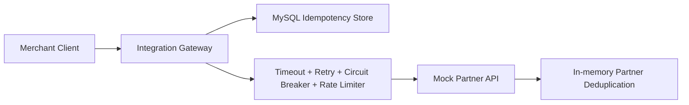
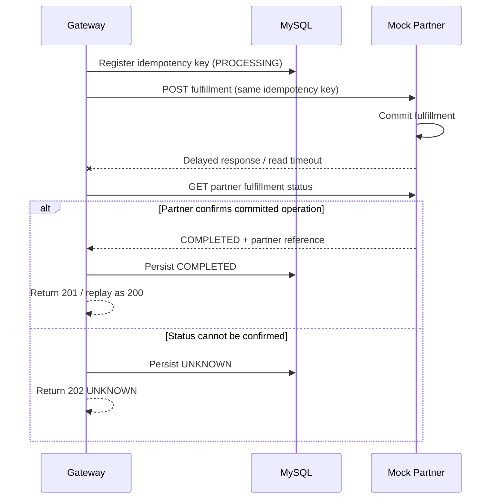

# Spring Boot Integration Lab

[](https://github.com/chen3862000-coder/spring-boot-integration-lab/actions/workflows/verify.yml)

Building Reliable Integrations with Unreliable External APIs.

This portfolio project demonstrates a focused e-commerce fulfillment gateway that integrates with an unreliable external partner API. It is not a CRUD application; it is a reliability engineering lab for outbound API integration.

## Architecture



Services:

- `integration-gateway`: public API, validation, MySQL-backed idempotency, partner HTTP client, Resilience4j, metrics, JSON logs.
- `mock-partner`: standalone partner simulator with deterministic fault injection and partner-side idempotency.
- `mysql`: durable gateway idempotency and fulfillment state.
- `prometheus`: optional metrics scraper using Docker Compose profile `observability`.

## Quick Start

Prerequisites:

- JDK 27
- Docker with Docker Compose
- k6 only for opt-in performance tests

Run the full stack:

```bash
docker compose up --build
```

Run tests:

```bash
./mvnw clean verify
make quality
make verify
```

GitHub Actions runs both `./mvnw clean verify` and a Docker Compose smoke job. The smoke job builds all three core services, waits for health, checks a normal fulfillment and timeout-after-commit reconciliation against the real mock partner, and removes its containers and volumes afterward.

Run performance tests after the stack is up:

```bash
make performance-test
```

## API Examples

Normal fulfillment:

```bash
curl -i -X POST http://localhost:8080/api/fulfillments \
  -H 'Content-Type: application/json' \
  -H 'Idempotency-Key: order-1001-fulfillment' \
  -H 'X-Correlation-ID: demo-1001' \
  -d '{"orderId":"ORDER-1001","sku":"SKU-001","quantity":2}'
```

Duplicate request with the same key and payload returns the stored result and does not call the partner again:

```bash
curl -i -X POST http://localhost:8080/api/fulfillments \
  -H 'Content-Type: application/json' \
  -H 'Idempotency-Key: order-1001-fulfillment' \
  -d '{"orderId":"ORDER-1001","sku":"SKU-001","quantity":2}'
```

Idempotency conflict:

```bash
curl -i -X POST http://localhost:8080/api/fulfillments \
  -H 'Content-Type: application/json' \
  -H 'Idempotency-Key: order-1001-fulfillment' \
  -d '{"orderId":"ORDER-OTHER","sku":"SKU-001","quantity":2}'
```

Injected partner failure:

```bash
curl -i -X POST http://localhost:8080/api/fulfillments \
  -H 'Content-Type: application/json' \
  -H 'Idempotency-Key: order-500-demo' \
  -H 'X-Partner-Fault: HTTP_500' \
  -d '{"orderId":"ORDER-500","sku":"SKU-001","quantity":1}'
```

Ambiguous timeout-after-commit:

```bash
curl -i -X POST http://localhost:8080/api/fulfillments \
  -H 'Content-Type: application/json' \
  -H 'Idempotency-Key: order-timeout-demo' \
  -H 'X-Partner-Fault: TIMEOUT_AFTER_COMMIT' \
  -d '{"orderId":"ORDER-TIMEOUT","sku":"SKU-001","quantity":1}'
```

Fetch current state:

```bash
curl -i http://localhost:8080/api/fulfillments/{requestId}
```

## Response Semantics

- `201 Created`: first request completed with confirmed partner success.
- `200 OK`: duplicate completed request returned from persisted idempotency state.
- `202 Accepted`: request is still `PROCESSING` or partner execution outcome is `UNKNOWN`.
- `400 Bad Request`: invalid payload or missing required header.
- `409 Conflict`: same `Idempotency-Key` with a different request payload.
- `429 Too Many Requests`: this gateway's outbound rate limiter rejected the call before partner transmission. Retrying the same key can reclaim the request after quota refresh.
- `502 Bad Gateway`: partner `4xx` other than `429`, or exhausted partner `5xx` retries.
- `503 Service Unavailable`: circuit breaker is open, or partner `429` retries were exhausted.
- An ambiguous write timeout or unreadable partner response returns `201` only if status reconciliation confirms completion; otherwise it remains `202 UNKNOWN`.
- Transient `429` and open-circuit outcomes persist as `RETRYABLE_FAILURE`; the same key and payload can retry later. Confirmed failures and `UNKNOWN` outcomes are not automatically reclaimed.

Statuses are intentionally conservative. A timeout during a write is not automatically treated as a business failure because the partner may already have processed the request.



## Reliability Patterns

- Timeout: Java HTTP client connect timeout defaults to `1s`; read timeout defaults to `2s`.
- Retry: Resilience4j retries selected retryable partner failures with exponential backoff. HTTP 400 is not retried.
- Circuit breaker: Resilience4j opens after repeated partner failures and rejects calls quickly while preserving gateway state.
- Rate limiting: each outbound partner HTTP attempt, including every retry, consumes a Resilience4j permit; the default is 10 attempts per second.
- Idempotency: MySQL unique constraint on `idempotency_key` prevents duplicate gateway execution ownership.
- Partner deduplication: the mock partner deduplicates writes by `Idempotency-Key`, demonstrating the external contract needed for safe retry.
- Reconciliation: ambiguous write timeouts are checked via `GET /partner/fulfillments/{partnerRequestId}` when possible.

Gateway idempotency does not provide distributed exactly-once execution. Exactly-once business effects require partner-side idempotency or another partner-supported deduplication contract.

## Failure Demonstrations

The Compose demo profile enables `X-Partner-Fault` forwarding to trigger deterministic partner behavior:

- `NORMAL`: success.
- `SLOW_RESPONSE`: slow but eventually successful response.
- `HTTP_500`: retryable server failure.
- `HTTP_429`: retryable rate-limit response when allowed by policy.
- `TIMEOUT_AFTER_COMMIT`: partner commits, then delays long enough for gateway timeout.
- `SERVICE_UNAVAILABLE`: simulated outage.

The fault header is for local demonstrations and automated tests. Do not expose unrestricted fault-injection controls in production systems. Upstream `429` is retried, then reported as `503` if the configured attempts are exhausted; gateway limiter rejection is `429`.

## Observability

Health and metrics:

```bash
curl http://localhost:8080/actuator/health
curl http://localhost:8080/actuator/prometheus
curl http://localhost:8080/actuator/circuitbreakers
```

Diagnostic Actuator endpoints and fault injection are enabled only in the local Compose `demo` profile. The default application profile exposes only health and info endpoints.

Metrics include gateway request counts, idempotency hits/conflicts, unknown outcomes, Resilience4j retry/circuit breaker/rate limiter metrics, and HTTP server/client metrics. Labels intentionally avoid order IDs, request IDs, and idempotency keys.

Logs are structured JSON and include `correlationId` from `X-Correlation-ID` when provided. The gateway propagates that header to the mock partner.

## Testing

The integration tests use Spring Boot Test, Testcontainers MySQL, and WireMock. They cover retry exhaustion, gateway limiter rejection, circuit open/recovery, and ambiguous timeout reconciliation in addition to idempotency behavior.

```bash
./mvnw clean verify
```

Covered scenarios include normal fulfillment, duplicate idempotency behavior, idempotency conflicts, concurrent duplicate requests, retry vs non-retry classification, timeout reconciliation, correlation propagation, and metrics exposure.

Docker is required for Testcontainers. If Docker is unavailable, integration tests cannot start MySQL.

## Verification Harness

`make verify` is the acceptance gate for the project. It runs Maven `clean verify`, which includes:

- Maven Enforcer: JDK 27 and dependency convergence.
- Checkstyle: class/method size, executable statement count, complexity, coupling, import hygiene, and basic maintainability rules.
- PMD CPD: duplicate-code detection for repeated blocks above 80 tokens.
- JaCoCo: minimum 70% class coverage and 70% method coverage per module.

The detailed acceptance checklist is in `config/acceptance/criteria.md`. Do not claim acceptance criteria or coverage targets passed unless `make verify` or `./mvnw clean verify` was executed successfully in a Docker-capable environment.

## Performance Testing

k6 scripts are opt-in:

```bash
BASE_URL=http://localhost:8080 k6 run performance/smoke.js
BASE_URL=http://localhost:8080 PROFILE=baseline k6 run performance/load.js
BASE_URL=http://localhost:8080 PROFILE=overload k6 run performance/load.js
BASE_URL=http://localhost:8080 PROFILE=fault k6 run performance/load.js
make performance-test
make performance-overload
make performance-fault
```

Profiles separate normal baseline behavior from intentional limiter overload and upstream failure injection. The duplicate model reuses the same idempotency key and payload twice per group. No benchmark results are included because k6 has not been run in this environment; record machine details, throughput, p95/p99, error rate, and gateway limiter response rate in `docs/performance-results.md` after execution.

## Trade-offs

- MySQL is used because idempotency state must survive gateway restarts and support uniqueness under concurrency.
- Database transactions are kept short and are not held open while waiting on the partner API.
- The mock partner uses in-memory deduplication for MVP simplicity; its idempotency state is not restart-safe.
- The rate limiter is process-local. Multiple gateway replicas would need distributed quota coordination for a shared partner limit.
- There is no background reconciliation worker in this MVP. Ambiguous operations are persisted and can be reconciled through partner status lookup.
- Authentication, authorization, tracing infrastructure, alerting, and multi-partner routing are intentionally out of scope. Compose credentials and fault injection are local-demo-only; published ports bind to loopback.

## Production Follow-up

Before public deployment, add authentication/authorization, secrets management, secured Actuator access, durable partner-side idempotency, distributed rate limiting, a reconciliation worker, and operational alerting. The included Compose profile is a local demonstration, not a production deployment configuration.

## Developer Commands

```bash
./mvnw clean verify
make run
make quality
make verify
make performance-test
```
