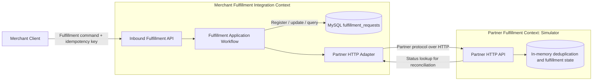
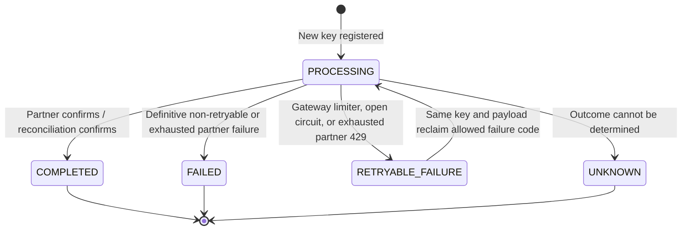

# System Design Through a Domain-Driven Design Lens

## Purpose and Scope

This document explains how the fulfillment integration lab applies Domain-Driven Design (DDD) concepts. It describes the system as implemented, identifies its bounded contexts and ubiquitous language, and shows how the design protects business invariants across an unreliable HTTP boundary.

It is written for engineers and architects evaluating the design. The core workflow — idempotent fulfillment submission, partner execution, and outcome recording — is the primary subject. Proposed future work is labeled as such and is not part of the current implementation.

The system is a fulfillment integration lab, not a complete commerce platform. It does not own order creation, inventory, payment, shipment planning, authentication, or multi-partner routing.

## Business Problem and Core Domain

The business problem is reliable command delivery across an unreliable external API. The important concern is not CRUD over fulfillment rows; it is deciding whether a fulfillment command may be sent, preventing duplicate business effects, and representing uncertainty honestly when the partner may have committed a write but the gateway did not receive a usable response.

The core workflow is:

1. A merchant submits an order line with an idempotency key.
2. The gateway validates the command and computes a request fingerprint.
3. The gateway claims durable execution ownership by creating an idempotency record.
4. The gateway calls the partner outside the database registration transaction.
5. The gateway records a confirmed result, confirmed failure, retryable dependency failure, or unknown outcome.
6. A duplicate request reuses the recorded result; the same key with a different payload is rejected.

Metrics, structured logging, health checks, and deterministic fault injection support operating and demonstrating this workflow. They do not define its business rules.

## Bounded Contexts

### Merchant Fulfillment Integration Context

This is the primary context and the gateway's responsibility. Its language includes idempotency key, request fingerprint, gateway request ID, partner request ID, fulfillment status, retryable dependency failure, and unknown outcome. It owns the public API semantics and the durable record in `fulfillment_requests`.

Implemented in `integration-gateway`, principally by:

- `api/FulfillmentController`: inbound HTTP contract and mapping of domain outcome to HTTP status.
- `application/FulfillmentService`: command orchestration, payload fingerprinting, partner outcome handling, and reconciliation.
- `persistence/FulfillmentRepository`, `FulfillmentRecord`, `FulfillmentStatus`, and `FailureCode`: persistence and retrieval of idempotency/fulfillment state.
- `client/PartnerClient`: outbound partner protocol and resilience boundary.

### Partner Fulfillment Context (Simulator)

The mock partner is a separate service and represents an independently owned external system. It accepts a partner request, deduplicates by idempotency key, creates a partner reference, and supports lookup by partner request ID. Its state and vocabulary are not the gateway's persistence model.

Implemented in `mock-partner` by `api/PartnerController`, `domain/PartnerFulfillmentService`, and `domain/PartnerFulfillment`. The simulator stores state in concurrent in-memory maps, so its idempotency and fulfillment history do not survive restart. It is an executable test double, not a production partner implementation.

### Supporting and Generic Concerns

Correlation IDs, metrics, health endpoints, structured logs, deployment configuration, and fault scenarios are supporting concerns. They cross-cut or facilitate the two contexts and are not part of the fulfillment aggregate. The gateway's `observability` package owns correlation propagation and gateway metrics; the partner's `fault` package supports local demonstration behavior.

## Context Map and Integration Boundary

The gateway consumes the partner's provider contract, while merchant clients consume the gateway's public contract. `PartnerClient` acts as the anti-corruption layer: it encapsulates partner URLs, headers, transport exceptions, response DTOs, and reliability policy so partner protocol details do not leak into the public API. The adapter is intentionally lightweight; the persistence record is passed to the client and partner DTOs are nested in the client class.

HTTP is the only service integration boundary. The partner does not access the gateway database or share application code. Partner-side idempotency is a cross-context contract required to make write retries safe. Gateway idempotency alone cannot guarantee exactly-once partner effects.

## Ubiquitous Language

| Term | Meaning in this system |
|---|---|
| Fulfillment request | A command to fulfill an order line, identified by order ID, SKU, and quantity. |
| Idempotency key | Merchant-provided identity for a logical submission; unique in gateway storage. |
| Request hash | SHA-256 fingerprint of the serialized request payload, used to detect key reuse with different input. |
| Gateway request ID | Generated `REQ-...` identity used to retrieve the gateway's durable outcome. |
| Partner request ID | Identifier sent to and used to query the partner. In this implementation it is the gateway request ID. |
| Partner reference | Partner-issued reference returned after confirmed processing. |
| Processing | Gateway has claimed the key and has not yet recorded a final or known dependency outcome. |
| Completed | Partner completion was confirmed directly or by status reconciliation. |
| Failed | A definitive partner/business-facing failure was received; it is not automatically reclaimed. |
| Retryable failure | The gateway did not complete partner execution because a transient gateway/partner dependency policy rejected it. Selected failure codes may be reclaimed by a later request with the same key and payload. |
| Unknown | The gateway cannot confirm whether the partner performed the operation. This is not equivalent to failure and is not automatically retried. |
| Failure code | A persisted classification such as `OUTBOUND_RATE_LIMITED`, `CIRCUIT_OPEN`, `PARTNER_RATE_LIMITED`, `PARTNER_FAILURE`, or `UNKNOWN_OUTCOME`. |
| Correlation ID | Diagnostic identifier propagated across the gateway and partner call; distinct from idempotency identity. |

The persisted status enum is `FulfillmentStatus` (`PROCESSING`, `COMPLETED`, `FAILED`, `RETRYABLE_FAILURE`, `UNKNOWN`). `FailureCode` refines the meaning of non-successful states.

## Domain Model

### Aggregate and Identity

The conceptual aggregate is a **Fulfillment Submission**, persisted as one `fulfillment_requests` row. It captures the submitted order line, request hash, status, partner identifiers/reference, failure information, and timestamps.

Identity is expressed in two complementary ways:

- `idempotency_key` identifies the merchant's logical submission and controls duplicate ownership.
- `request_id` provides the durable, externally readable identity used by `GET /api/fulfillments/{requestId}`.

The implementation is deliberately pragmatic. `FulfillmentRecord` is an immutable persistence record, while orchestration and transition rules live in `FulfillmentService` and `FulfillmentRepository`. Database constraints enforce the critical concurrency invariant. This keeps the compact service explicit and straightforward to test.

| DDD concept | Implementation | Design intent |
|---|---|---|
| Aggregate root | Fulfillment submission, persisted as one row | One durable record owns the current outcome and identifiers. |
| Entity identity | `idempotencyKey` and `requestId` | The key controls duplicate submission; the request ID supports reads. |
| Value objects | `FulfillmentRequest` and partner DTOs as Java records | Boundary validation captures required input, while partner protocol stays in the adapter. |
| Application service | `FulfillmentService` | Coordinates idempotency, partner I/O, persistence, metrics, and outcome classification. |
| Repository | `FulfillmentRepository` | Transactional registration, reclamation, and result updates with JDBC. |
| Domain events | None | State changes are persisted synchronously; no event publication or outbox is required for the current workflow. |

### Invariants

These rules are enforced across SQL constraints, repository operations, and application orchestration:

- An idempotency key identifies at most one gateway record (`uq_fulfillment_idempotency` in `schema.sql`).
- A request ID identifies at most one gateway record (`uq_fulfillment_request_id`).
- The same key and request hash must not create another partner operation; completed submissions replay stored state.
- Reusing a key with a different request hash is a conflict and returns HTTP 409.
- Registration ownership is decided by the database before calling the partner. The registration transaction is not held open during network I/O.
- Only `RETRYABLE_FAILURE` records with an allowed failure code (`OUTBOUND_RATE_LIMITED`, `CIRCUIT_OPEN`, `PARTNER_RATE_LIMITED`) can be reclaimed by the same key and payload.
- An ambiguous write outcome must not be reported as a confirmed failure. The gateway attempts partner status reconciliation; if that does not confirm success, it records `UNKNOWN`.
- Partner writes use the same idempotency key so the provider can deduplicate retries. This is an external contract, not a guarantee provided by the gateway database.

### State Lifecycle

The reclamation transition is guarded by both status and failure code. Duplicate `PROCESSING` requests may be returned as-is while the first submission is still executing; the POST path does not wait or poll. A background transition from `UNKNOWN` to a later confirmed status is not part of the current implementation.

## Application Workflows

### Submit Fulfillment

`POST /api/fulfillments` validates the request and required `Idempotency-Key`, hashes the request, then calls `FulfillmentRepository.register`. A newly registered request becomes `PROCESSING` and is eligible for one gateway execution owner. A duplicate with the same payload returns its current stored record. A duplicate with a different payload throws `IdempotencyConflictException`.

The owner calls `PartnerClient.createFulfillment` outside the registration transaction. Resilience4j applies circuit-breaker, retry, and rate-limiter behavior around HTTP attempts. Confirmed partner success is persisted as `COMPLETED`; classified failures are stored with distinct failure codes and statuses. A transport-level ambiguous write invokes partner status lookup. The HTTP response is a projection from persisted state: commonly 201 for a newly completed request, 200 for a replayed completed request, 202 for processing/unknown, 409 for conflicting key reuse, and dependency-specific 429/502/503 outcomes.

### Read Fulfillment

`GET /api/fulfillments/{requestId}` reads persisted gateway state and returns a response projection, or 404 when no request exists. It reads gateway state only; it does not query the partner or reconcile pending/unknown operations.

### Partner Write and Reconciliation

The gateway sends partner request ID, order ID, SKU, and quantity, along with idempotency and correlation headers. For an ambiguous transport failure it attempts `GET /partner/fulfillments/{partnerRequestId}`. A confirmed partner record updates the gateway record to `COMPLETED`; inability to confirm produces `UNKNOWN`. The GET reconciliation path is not wrapped in the POST operation's retry, circuit-breaker, or rate-limiter decorators.

## Architecture and Dependency Direction

The runtime is a Maven multi-module system: `integration-gateway` and `mock-partner` are independently runnable Spring Boot services. MySQL is used only by the gateway. Docker Compose adds MySQL and optional Prometheus, while the mock partner keeps state in process memory.

Within the gateway, the effective request path is:

`HTTP Controller -> FulfillmentService -> (FulfillmentRepository, PartnerClient, metrics) -> MySQL / partner HTTP`

This is a pragmatic layered architecture rather than a strict hexagonal model. It keeps the workflow readable and the integration tests focused. Package ownership still makes the intended boundaries clear: HTTP and DTO concerns live under `api`, orchestration under `application`, persistence under `persistence`, partner protocol under `client`, and cross-cutting diagnostics under `observability`.

The mock partner has a simpler path:

`PartnerController -> PartnerFulfillmentService -> in-memory maps`

## Consistency, Reliability, and Failure Semantics

- **Local atomicity:** MySQL uniqueness arbitrates concurrent idempotency-key claims. Registration and state updates are short transactions.
- **No distributed transaction:** partner HTTP calls are outside the MySQL transaction. A crash can occur between partner processing and gateway result persistence.
- **At-least-once risk:** retries can repeat partner writes. Partner-side deduplication is necessary to prevent duplicate business effects; its in-memory implementation is illustrative and not restart-safe.
- **Honest ambiguity:** timeout or an unreadable response is not proof of failure. Reconciliation may confirm completion; otherwise `UNKNOWN` remains visible as HTTP 202.
- **Selective reclamation:** gateway limiter rejection, open circuit, and exhausted partner 429 are stored as retryable. The same key and payload can attempt later. Confirmed failures and unknown outcomes are not automatically reclaimed.
- **Process-local protection:** Resilience4j rate limiting and circuit-breaker state are local to a gateway process. Multiple replicas would not share quota or breaker state.
- **No asynchronous recovery:** there is no outbox, queue, scheduled reconciliation worker, or operator workflow for resolving unknown outcomes.

These behaviors make the system a synchronous request/reply integration with durable request state, not an asynchronous process manager or saga implementation.

## External Contracts and API Semantics

The merchant contract is under `/api/fulfillments`. The partner contract is under `/partner/fulfillments` and is deliberately separate. The gateway owns merchant-facing status and error semantics; partner transport status is translated into gateway status and failure codes rather than passed through unchanged.

Correlation IDs are generated if absent, rejected if longer than 128 characters, returned on the gateway response, added to logging context, and propagated to the partner. They are diagnostic only and must not substitute for idempotency keys. Metrics avoid high-cardinality business identifiers.

`X-Partner-Fault` is forwarded only when the gateway demo profile enables fault injection. It is a lab/testing mechanism and must not be exposed as an unrestricted production feature.

## Design Strengths

- The system has a coherent domain focus: safe fulfillment integration under unreliable partner behavior.
- Gateway and partner state have separate ownership and communicate through a clear HTTP boundary.
- Idempotency, ambiguous outcomes, and retry eligibility are explicit business-relevant concepts rather than hidden in generic CRUD behavior.
- Database constraints protect a concurrency invariant across threads and gateway instances.
- Public response semantics reflect confirmed versus uncertain outcomes.
- Integration tests exercise duplicate submissions, concurrent ownership, retry classification, and reconciliation behavior.

## Deliberate Scope Boundaries

The current design intentionally favors clarity over production breadth. The following are out of scope and documented as such:

- Authentication and authorization.
- Secret management and secured Actuator access.
- Durable partner-side idempotency.
- Distributed rate limiting across gateway replicas.
- A reconciliation worker or operator workflow for `UNKNOWN` outcomes.
- Event publication, an outbox, or a message broker.
- Production alerting and distributed tracing.

These omissions keep the reliability patterns visible and avoid implying guarantees the system does not provide, particularly distributed exactly-once execution.

When evolving toward a production deployment, likely next steps include:

1. Introduce a richer domain model if business rules grow beyond the current workflow, with explicit value objects such as `IdempotencyKey`, `RequestId`, and `FulfillmentLine`.
2. Define application ports for submission persistence and partner fulfillment/status lookup, with JDBC and HTTP implementations in dedicated adapters.
3. Add durable partner-side idempotency and a reconciliation worker for operations that remain `UNKNOWN`.
4. Coordinate rate limits and circuit state across replicas, or move quota enforcement to a shared gateway layer.
5. Add authentication, secret management, alerting, and production-grade tracing.

These are evolution options, not current capabilities.

## Tests as Design Evidence

The test suite documents the most important rules:

| Behavior | Evidence |
|---|---|
| Same key + same payload replays without another partner write | `FulfillmentIdempotencyTests.duplicateRequestReturnsStoredResultWithoutCallingPartnerAgain` |
| Same key + different payload conflicts | `FulfillmentIdempotencyTests.sameKeyWithDifferentPayloadReturnsConflict` |
| Concurrent duplicates have only one partner operation owner | `FulfillmentIdempotencyTests.concurrentDuplicateRequestsCreateOnlyOnePartnerOperation` |
| Transient partner failures retry; non-retryable status does not | `FulfillmentResilienceTests.serverFailureRetriesButBadRequestDoesNot` |
| Ambiguous timeout can reconcile to completed or remain unknown | `FulfillmentResilienceTests.timeoutAfterCommitReconcilesWithoutDuplicateWrite`, `missingPartnerStatusLeavesAmbiguousWriteUnknown` |
| Selected transient failures can be retried later using the same key | `partnerRateLimitCanBeRetriedLaterWithSameIdempotencyKey`, `openCircuitReturns503AndLaterSameKeyCanRecover`, and `outboundLimiterRejectsAndAllowsSameKeyRetryAfterRefresh` |
| Correlation is propagated and metrics exposed | `FulfillmentValidationAndObservabilityTests.correlationIdPropagatesAndMetricsAreExposed` |

The tests are integration-heavy, using Spring Boot, MySQL Testcontainers, and WireMock. They focus on the persistence and concurrency behavior most likely to regress in an integration service.

## Operational and Deployment View

Docker Compose runs `integration-gateway`, `mock-partner`, and `mysql`; Prometheus is an optional `observability` profile service. Gateway data is durable in MySQL, while partner deduplication is process-local. The default application profile exposes only health and info; the demo profile enables fault injection and diagnostic Actuator endpoints. Credentials and published ports in Compose are local-demo defaults, not production deployment settings.

## Source Map

- Build/module boundaries: `pom.xml`, `integration-gateway/pom.xml`, `mock-partner/pom.xml`
- Gateway HTTP contract: `integration-gateway/src/main/java/com/example/integrationgateway/api/`
- Gateway command orchestration: `integration-gateway/src/main/java/com/example/integrationgateway/application/FulfillmentService.java`
- Gateway persistence model/schema: `integration-gateway/src/main/java/com/example/integrationgateway/persistence/`, `integration-gateway/src/main/resources/schema.sql`
- Partner protocol and resilience: `integration-gateway/src/main/java/com/example/integrationgateway/client/PartnerClient.java`, `integration-gateway/src/main/resources/application.yml`
- Partner simulator: `mock-partner/src/main/java/com/example/mockpartner/`
- Deployment wiring: `compose.yaml`
- Runtime and failure documentation: `README.md`, `docs/architecture.md`, `docs/design-decisions.md`, `docs/failure-scenarios.md`
