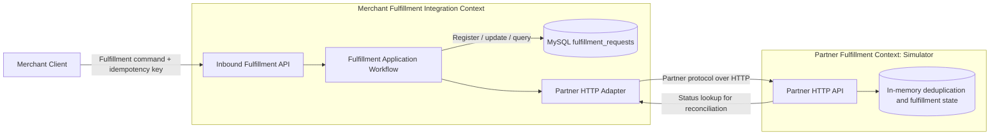
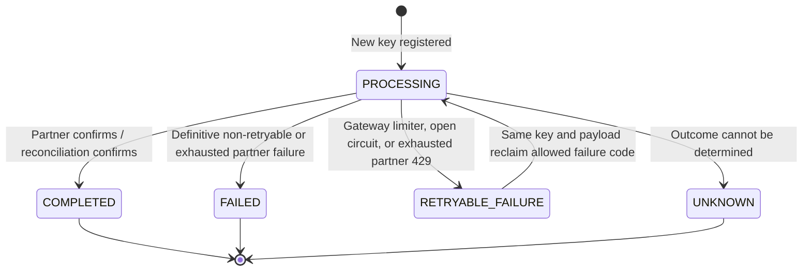

# System Design Through a DDD Lens

## Purpose and Scope

This document analyzes the implementation in this repository using Domain-Driven Design (DDD) concepts. It describes the system as it exists, then identifies where its design aligns with DDD and where a future domain-focused refactoring could help. Proposed concepts are explicitly distinguished from implemented classes.

The system is a fulfillment integration lab, not a complete commerce platform. It accepts a merchant fulfillment request, protects that write against duplicate submissions and unreliable partner behavior, and exposes the outcome. It does not own order creation, inventory, payment, shipment planning, authentication, or multi-partner routing.

## Domain and Business Problem

The business problem is reliable command delivery across an unreliable HTTP boundary. The important business concern is not CRUD over fulfillment rows; it is deciding whether a fulfillment command may be sent, preventing duplicate effects where possible, and representing uncertainty honestly when the partner may have committed a write but the gateway did not receive a usable response.

The core workflow is:

1. A merchant submits an order/SKU/quantity with an idempotency key.
2. The gateway validates and fingerprints the command.
3. The gateway claims execution ownership by creating a durable idempotency record.
4. The gateway calls the partner outside the database registration transaction.
5. The gateway stores a confirmed result, confirmed failure, retryable dependency failure, or unknown outcome.
6. A duplicate request reuses the recorded result; a key reused with a different payload is rejected.

This is the system's core domain. Metrics, JSON logging, health checks, and fault injection support operating and demonstrating that workflow, but do not define its business rules.

## Bounded Contexts

### Merchant Fulfillment Integration Context

This is the primary context and the gateway's responsibility. Its language includes `Idempotency-Key`, request fingerprint, gateway request ID, partner request ID, fulfillment status, retryable dependency failure, and unknown outcome. It owns the public API semantics and the durable record in `fulfillment_requests`.

Implemented in `integration-gateway`, principally by:

- `api/FulfillmentController`: inbound HTTP contract and mapping of domain outcome to HTTP status.
- `application/FulfillmentService`: command orchestration, payload fingerprinting, partner outcome handling, and reconciliation.
- `persistence/FulfillmentRepository` and `FulfillmentRecord`: persistence and retrieval of idempotency/fulfillment state.
- `client/PartnerClient`: outbound partner protocol and resilience boundary.

### Partner Fulfillment Context (Simulator)

The mock partner is a separate service and represents an independently owned external system. It accepts a partner request, deduplicates by idempotency key, creates a partner reference, and allows lookup by partner request ID. Its state and vocabulary are not the gateway's persistence model.

Implemented in `mock-partner` by `api/PartnerController`, `domain/PartnerFulfillmentService`, and `domain/PartnerFulfillment`. The simulator stores state in concurrent in-memory maps, so its idempotency and fulfillment history do not survive restart. It is an executable test double, not a production partner implementation.

### Supporting / Generic Concerns

Correlation IDs, metrics, health endpoints, structured logs, deployment configuration, and deterministic fault scenarios are supporting concerns. They cross-cut or facilitate the two contexts; they should not be modeled as part of the fulfillment aggregate. The integration gateway's `observability` package owns correlation propagation and gateway metrics. The partner's `fault` package supports local demonstration behavior.

## Context Map and Integration



The gateway consumes the partner's provider contract, while merchant clients consume the gateway's public contract. `PartnerClient` is the natural anti-corruption layer: it encapsulates partner URLs, headers, transport exceptions, response DTOs, and reliability policy so partner protocol details do not leak into the public API. The current implementation is a lightweight adapter rather than a complete translation layer; the persistence `FulfillmentRecord` is passed to the client and the partner DTOs are nested in the client class.

HTTP is the only service integration boundary. The partner does not access the gateway database or share its application code. The partner idempotency key is a cross-context contract required to deduplicate writes. Gateway idempotency alone cannot guarantee exactly-once partner effects.

## Ubiquitous Language

| Term | Meaning in this system |
|---|---|
| Fulfillment request | A command to fulfill an order line, identified by order ID, SKU, and quantity. |
| Idempotency key | Merchant-provided identity for a logical submission; unique in gateway storage. |
| Request hash | SHA-256 fingerprint of the serialized request payload, used to detect key reuse with different input. |
| Gateway request ID | Generated `REQ-...` identity used to retrieve the gateway's durable outcome. |
| Partner request ID | Identifier sent to and used to query the partner. In this implementation it is the gateway request ID. |
| Partner reference | Partner-issued reference returned after confirmed processing. |
| Processing | Gateway has claimed the key and has not yet recorded a final/known dependency outcome. |
| Completed | Partner completion was confirmed directly or by status reconciliation. |
| Failed | A definitive partner/business-facing failure was received; it is not automatically reclaimed. |
| Retryable failure | The gateway did not complete partner execution because a transient gateway/partner dependency policy rejected it. Selected failure codes may be reclaimed by a later request with the same key and payload. |
| Unknown | The gateway cannot confirm whether the partner performed the operation. This is not equivalent to failure and is not automatically retried. |
| Correlation ID | Diagnostic identifier propagated across the gateway and partner call; distinct from idempotency identity. |

The persisted enum is `FulfillmentStatus` (`PROCESSING`, `COMPLETED`, `FAILED`, `RETRYABLE_FAILURE`, `UNKNOWN`). Failure codes refine the meaning of `RETRYABLE_FAILURE` and `FAILED`; for example `OUTBOUND_RATE_LIMITED`, `CIRCUIT_OPEN`, `PARTNER_RATE_LIMITED`, `PARTNER_FAILURE`, and `UNKNOWN_OUTCOME`.

## Domain Model: Current Implementation and DDD Interpretation

### Candidate Aggregate

The natural conceptual aggregate is a **Fulfillment Submission** (the current durable `FulfillmentRecord` row), identified by its idempotency key and gateway request ID. It captures the submitted order line, request hash, status, partner identifiers/reference, failure information, and timestamps.

This is a conceptual model, not a rich aggregate currently implemented in Java. `FulfillmentRecord` is an immutable data record in the `persistence` package. It exposes no behavior or invariant enforcement. The workflow rules live primarily in `FulfillmentService` and `FulfillmentRepository`, while `FulfillmentStatus` is also in the persistence package. The gateway is therefore layered and domain-oriented, but not a strict tactical DDD implementation.

| DDD concept | Current representation | Assessment |
|---|---|---|
| Aggregate root | Conceptually the fulfillment submission; concretely `FulfillmentRecord` plus repository operations | State is persisted as one row; invariants are split across application and repository code. |
| Entity identity | `requestId` and unique `idempotencyKey` | Both are durable identifiers; request ID is exposed for reads, key controls duplicate submission. |
| Value objects | No explicit domain value-object types | `FulfillmentRequest` and partner DTOs are Java records, but belong to API/client boundaries and do not enforce richer domain semantics. |
| Domain service | No explicit pure domain service in the gateway | `FulfillmentService` is primarily an application service coordinating I/O, persistence, metrics, and decisions. `PartnerFulfillmentService` is simulator-side in-memory application/domain logic. |
| Repository | `FulfillmentRepository` | JDBC repository with transactional registration and result updates. It also contains retry-reclamation policy, which is domain decision logic mixed into persistence. |
| Domain events | None | State changes are persisted synchronously; there is no event publication or outbox. |

### Invariants Evident in the Code

- An idempotency key identifies at most one gateway record (`uq_fulfillment_idempotency` in `schema.sql`).
- A request ID identifies at most one gateway record (`uq_fulfillment_request_id`).
- The same key and same request hash must not create another partner operation; repeated completed submissions replay stored state.
- Reusing a key with a different request hash is a conflict and returns HTTP 409.
- Registration ownership is decided by the database before calling the partner. The short registration transaction is not held open during network I/O.
- Only `RETRYABLE_FAILURE` records with the explicitly allowed failure codes (`OUTBOUND_RATE_LIMITED`, `CIRCUIT_OPEN`, `PARTNER_RATE_LIMITED`) can be reclaimed by the same key and payload.
- An ambiguous write outcome must not be reported as a confirmed failure. The gateway attempts partner status reconciliation; if that does not confirm success, it records `UNKNOWN`.
- Partner writes use the same idempotency key so the provider can deduplicate retries. This is an external contract, not a guarantee provided by the gateway database.

These rules are enforced across SQL constraints, repository operations, and application orchestration, rather than in a single aggregate boundary. Any future refactor must preserve their atomicity and concurrency behavior.

### State Lifecycle



The arrow from `RETRYABLE_FAILURE` is guarded by both the status and the failure code, not just by the enum. `PROCESSING` duplicates may be returned as-is while the first submission is still executing. There is no waiting/polling behavior in the POST path. The current design does not implement a background transition from `UNKNOWN` to a later confirmed status.

## Application Workflows

### Submit Fulfillment

`POST /api/fulfillments` validates the request and required `Idempotency-Key`, hashes the request, then calls `FulfillmentRepository.register`. A newly registered request becomes `PROCESSING` and is eligible for one gateway execution owner. A duplicate with the same payload returns its current stored record. A duplicate with a different payload throws `IdempotencyConflictException`.

The owner calls `PartnerClient.createFulfillment` outside the registration transaction. Resilience4j applies circuit-breaker, retry, and rate-limiter behavior around HTTP attempts. Confirmed partner success is persisted as `COMPLETED`; classified failures are stored with distinct failure codes/statuses. A transport-level ambiguous write invokes partner status lookup. The HTTP response is a projection from persisted state: commonly 201 for a newly completed request, 200 for a replayed completed request, 202 for processing/unknown, 409 for conflicting key reuse, and dependency-specific 429/502/503 outcomes.

### Read Fulfillment

`GET /api/fulfillments/{requestId}` reads the persisted gateway state and returns a response projection, or 404 when no request exists. It reads gateway state only; it does not query the partner or reconcile pending/unknown operations.

### Partner Write and Reconciliation

The gateway sends partner request ID, order ID, SKU, and quantity, along with idempotency and correlation headers. For an ambiguous transport failure, it attempts `GET /partner/fulfillments/{partnerRequestId}`. A confirmed partner record updates the gateway record to `COMPLETED`; inability to confirm produces `UNKNOWN`. The GET reconciliation path is not wrapped in the same retry/circuit-breaker/rate-limiter call as the POST in `PartnerClient`.

## Architecture and Dependency Direction

The runtime is a Maven multi-module system (`pom.xml`): `integration-gateway` and `mock-partner` are independently runnable Spring Boot services. MySQL is used only by the gateway. Docker Compose adds MySQL and optional Prometheus, while the mock partner keeps state in process memory.

Within the gateway, the effective request path is:

`HTTP Controller -> FulfillmentService -> (FulfillmentRepository, PartnerClient, metrics) -> MySQL / partner HTTP`

This is a pragmatic layered architecture. It is not strict hexagonal/clean architecture: the application service imports API request and persistence types, the client accepts a persistence record, and framework annotations sit directly on application-facing classes. Those dependencies are tolerable for this small lab, but they make the domain model harder to reuse independently of HTTP/JDBC/Spring.

The mock partner has a simpler path:

`PartnerController -> PartnerFulfillmentService -> in-memory maps`

## Consistency, Reliability, and Failure Semantics

- **Local atomicity:** MySQL uniqueness arbitrates concurrent idempotency-key claims. Registration and state updates are short transactions.
- **No distributed transaction:** partner HTTP calls are outside the MySQL transaction. A crash can occur between partner processing and gateway result persistence.
- **At-least-once risk:** retries can repeat partner writes. Partner-side deduplication is necessary to prevent duplicate business effects; its in-memory implementation is illustrative and not restart-safe.
- **Honest ambiguity:** timeout or unreadable response is not proof of failure. Reconciliation may confirm completion; otherwise `UNKNOWN` remains visible as HTTP 202.
- **Selective reclamation:** gateway limiter rejection, open circuit, and exhausted partner 429 are stored as retryable. Same key and payload can attempt later. Confirmed failures and unknown outcomes are not auto-reclaimed.
- **Process-local protection:** Resilience4j rate limiting and circuit-breaker state are local to a gateway process. Multiple replicas would not share quota or breaker state.
- **No asynchronous recovery:** there is no outbox, queue, scheduled reconciliation worker, or operator workflow for resolving unknown outcomes.

These behaviors make the system a synchronous request/reply integration with durable request state, not an asynchronous process manager or saga implementation.

## External Contracts and API Semantics

The merchant contract is under `/api/fulfillments`. The partner contract is under `/partner/fulfillments` and is deliberately separate. The gateway owns merchant-facing status and error semantics; partner transport status is translated into gateway status/failure codes rather than passed through unchanged.

Correlation IDs are generated if absent, rejected if longer than 128 characters, returned on the gateway response, added to logging context, and propagated to the partner. They are diagnostic only and must not substitute for idempotency keys. Metrics avoid high-cardinality business identifiers.

`X-Partner-Fault` is forwarded only when the gateway demo profile enables fault injection. It is a lab/testing mechanism and must not be exposed as an unrestricted production feature.

## DDD Assessment

### What Is Already Strong

- The system has a coherent domain focus: safe fulfillment integration under unreliable partner behavior.
- Gateway and partner state have separate ownership and communicate through a clear HTTP boundary.
- Idempotency, ambiguous outcomes, and retry eligibility are explicit business-relevant concepts rather than hidden in generic CRUD behavior.
- Database constraints protect a concurrency invariant across threads and gateway instances.
- Public response semantics reflect confirmed versus uncertain outcomes.
- Tests exercise duplicate submissions, concurrent ownership, retry classification, and reconciliation behavior.

### Current DDD Gaps

- The gateway's `FulfillmentRecord` is a persistence DTO, not an invariant-protecting aggregate; business state transitions are coordinated across service and repository code.
- Domain types live in `persistence`, and `FulfillmentService` depends directly on API request and JDBC-facing records. Domain/application/infrastructure boundaries are not explicit.
- Request hash generation and eligibility decisions are application/repository implementation details rather than named domain concepts/policies.
- `FulfillmentRepository.register` combines persistence with the rule for which retryable failures may be reclaimed.
- Partner transport DTOs are nested in `PartnerClient`, while that client also owns HTTP setup and resilience policy; protocol mapping and reliability concerns are coupled.
- The mock partner's `PartnerFulfillmentService` is named as a domain service but primarily performs in-memory storage/deduplication. It is intentionally not durable business infrastructure.
- There are no explicit value objects, domain events, or unit tests of aggregate transitions because there is no rich gateway aggregate today.

These are scope/architecture observations, not defects that prevent the current lab from demonstrating its stated reliability goals.

## Pragmatic Evolution Toward DDD

For this project, DDD should clarify rules without introducing needless ceremony or splitting a small service into many modules.

1. **Name the core model.** Introduce a domain `FulfillmentSubmission` (or `FulfillmentAttempt`) with identity and methods for allowed transitions. Move `FulfillmentStatus` and transition/failure semantics out of `persistence`.
2. **Use small value objects where they protect rules.** Candidates include `IdempotencyKey`, `RequestId`, `RequestFingerprint`, and `FulfillmentLine` (order ID, SKU, positive quantity). Keep HTTP validation at the edge, with domain constructors enforcing essential invariants as well.
3. **Define application ports.** The application workflow should depend on interfaces for submission persistence and partner fulfillment/status lookup. JDBC and Spring HTTP implementations should live in infrastructure adapters.
4. **Keep the aggregate boundary aligned with concurrency.** Preserve database uniqueness and atomic claim/reclaim semantics. If domain transitions are loaded and saved, use optimistic versioning or conditional SQL updates so concurrent callers cannot both own a transition.
5. **Separate partner protocol mapping.** Map a domain command to partner request DTOs and partner responses back to domain outcomes inside the adapter. Do not pass a persistence record to the partner client.
6. **Add recovery only if product requirements call for it.** A durable reconciliation queue/worker and operational resolution path would be the next meaningful domain capability; adding domain events or a message broker before that need is established would be premature.

A future package direction could be:

```text
integration-gateway
  domain/fulfillment/       FulfillmentSubmission, status, value objects, transition rules
  application/               SubmitFulfillment, GetFulfillment, orchestration ports
  adapter/in/web/            REST controller, request/response DTOs, exception mapping
  adapter/out/mysql/         JDBC repository implementation and row mapping
  adapter/out/partner/       Partner HTTP client, protocol mapping, resilience configuration
  adapter/observability/     correlation, metrics, structured logging
```

This is a suggested direction only; it is not the current source layout. A first refactoring should be incremental and retain the existing API, SQL uniqueness guarantees, and integration tests.

## Tests as Domain Evidence

The test suite documents the most important rules:

| Behavior | Evidence |
|---|---|
| Same key + same payload replays without another partner write | `FulfillmentIdempotencyTests.duplicateRequestReturnsStoredResultWithoutCallingPartnerAgain` |
| Same key + different payload conflicts | `FulfillmentIdempotencyTests.sameKeyWithDifferentPayloadReturnsConflict` |
| Concurrent duplicates have only one partner operation owner | `FulfillmentIdempotencyTests.concurrentDuplicateRequestsCreateOnlyOnePartnerOperation` |
| Transient partner failures retry; non-retryable status does not | `FulfillmentResilienceTests.serverFailureRetriesButBadRequestDoesNot` |
| Ambiguous timeout can reconcile to completed or remain unknown | `FulfillmentResilienceTests.timeoutAfterCommitReconcilesWithoutDuplicateWrite`, `missingPartnerStatusLeavesAmbiguousWriteUnknown` |
| Selected transient failures can be retried later using the same key | `partnerRateLimitCanBeRetriedLaterWithSameIdempotencyKey`, `openCircuitReturns503AndLaterSameKeyCanRecover`, and `outboundLimiterRejectsAndAllowsSameKeyRetryAfterRefresh` |
| Correlation is propagated and metrics exposed | `FulfillmentValidationAndObservabilityTests.correlationIdPropagatesAndMetricsAreExposed` |

The tests are integration-heavy, using Spring Boot, MySQL Testcontainers, and WireMock. If a rich aggregate is introduced, add focused domain unit tests for legal/illegal status transitions and retry eligibility while retaining the existing persistence/concurrency integration tests.

## Operational and Deployment View

Docker Compose runs `integration-gateway`, `mock-partner`, and `mysql`; Prometheus is an optional `observability` profile service. Gateway data is durable in MySQL, while partner deduplication is process-local. The default application profile exposes only health/info; demo configuration enables fault injection and diagnostic actuator endpoints. Credentials and published ports in Compose are local-demo defaults, not production deployment settings.

Operational production concerns intentionally absent include authentication/authorization, secret management, distributed rate/quota coordination, durable partner idempotency, a reconciliation worker, alerting, and production-grade tracing. Refer to `docs/architecture.md`, `docs/design-decisions.md`, `docs/failure-scenarios.md`, and the README for the existing runtime and reliability details.

## Source Map

- Build/module boundaries: `pom.xml`, `integration-gateway/pom.xml`, `mock-partner/pom.xml`
- Gateway HTTP contract: `integration-gateway/src/main/java/com/example/integrationgateway/api/`
- Gateway command orchestration: `integration-gateway/src/main/java/com/example/integrationgateway/application/FulfillmentService.java`
- Gateway persistence model/schema: `integration-gateway/src/main/java/com/example/integrationgateway/persistence/`, `integration-gateway/src/main/resources/schema.sql`
- Partner protocol and resilience: `integration-gateway/src/main/java/com/example/integrationgateway/client/PartnerClient.java`, `integration-gateway/src/main/resources/application.yml`
- Partner simulator: `mock-partner/src/main/java/com/example/mockpartner/`
- Deployment wiring: `compose.yaml`
- Existing design and runtime documentation: `docs/architecture.md`, `docs/design-decisions.md`, `README.md`
